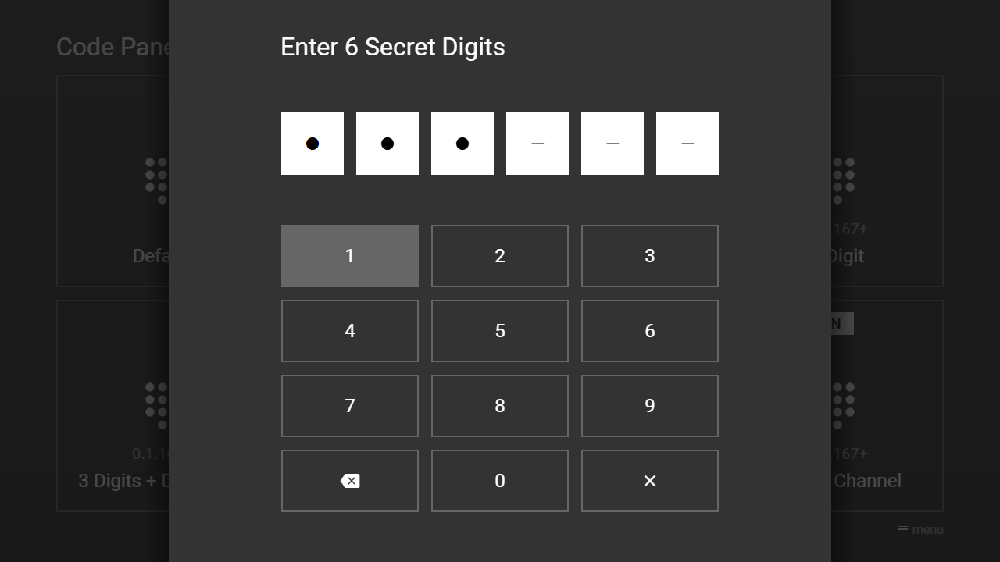

# Code Panel

It is possible to enter codes (i.e. numbers) with the integrated code panel. These codes can either be processed at the server or plugin level or embedded directly into action strings. This feature is available since version **0.1.0**, but was significantly expanded in version **0.1.167**.

## Usage

There are various actions for opening the code panel. The code is processed according to the specific action. Depending on the configuration, the entered code can have the following lengths.

- Default: **1 to 32 digits**
- Secret (`secret` property is set to `true`): **1 to 16 digits**
- Fixed number of digits (`digits` property is set): **1 to 8 digits**

Action syntax of code panel actions.

| Syntax | Example | Since Version | Description |
|---|---|---|---|
| `enter` | `enter` | **0.1.167** | The entered code is embedded in the indicated action by replacing the keyword `{CODE}` (e.g. `"info:You have entered the code: {col:msx-white}{CODE}"`). The data must contain an `action` property (of type `string`) and can optionally contain an action-related `data` property (of type `object`). |
| `enter:{CODE}` | `enter:1234` | 0.1.0 | If the entered code is correct, the indicated action is executed. The data must contain an `action` property (of type `string`) and can optionally contain an action-related `data` property (of type `object`). |
| `execute:code:{URL}`<br>`execute:code:accurate:{URL}`<br>`execute:code:request:interaction:{DATA_ID}`<br>`execute:code:request:interaction:{DATA_ID}@{URL}`<br>`execute:code:request:player:{DATA_ID}`<br>`execute:code:user:{URL}`<br>`execute:code:user:accurate:{URL}` | `execute:code:http://msx.benzac.de/services/echo.php`<br>`execute:code:accurate:http://msx.benzac.de/services/echo.php`<br>`execute:code:request:interaction:custom_data_id`<br>`execute:code:request:interaction:custom_data_id@http://msx.benzac.de/interaction/template.html`<br>`execute:code:request:player:custom_data_id`<br>`execute:code:user:http://msx.benzac.de/services/echo.php`<br>`execute:code:user:accurate:http://msx.benzac.de/services/echo.php` | **0.1.30** | Executes an action on server side, the player, or the interaction plugin with an entered code and returns an action to be executed (e.g. to show a success/error message).<br><br>Please see [Actions → Server Actions](../../main-api/common/actions.md#server-actions) for more information. |
| `interaction:commit:code` | `interaction:commit:code` | **0.1.82** | Commits a code to the interaction plugin. |
| `player:commit:code` | `player:commit:code` | **0.1.40** | Commits a code to the video/audio plugin. |

## Syntax

Property syntax of code panel data object.

| Property | Type | Default Value | Mandatory | Since Version | Description |
|---|---|---|---|---|---|
| `headline` | `string` | `"Enter Code"` | No | 0.1.0 | The headline of the code panel.<br><br>This property supports [Inline Expressions](../../main-api/common/inline-expressions.md). |
| `extension` | `string` | `null` | No | 0.1.0 | The extension of the code panel. This property can be used to display a small label in the upper right corner.<br><br>This property supports [Inline Expressions](../../main-api/common/inline-expressions.md) and [Live Inline Expressions](../live/live-inline-expressions.md). |
| `description` | `string` | `null` | No | **0.1.167** | The description of the code panel.<br><br>This property supports [Inline Expressions](../../main-api/common/inline-expressions.md).<br><br>**Note: This property is only used if the `digits` property is set.** |
| `value` | `string` | `null` | No | 0.1.0 | The initial value of the code panel. The value must consist only of numbers and must not exceed the maximum length, otherwise it is ignored. |
| `placeholder` | `string` | `"Code"` | No | 0.1.0 | The placeholder value of the code panel. This value is displayed if no code is entered.<br><br>This property supports [Inline Expressions](../../main-api/common/inline-expressions.md).<br><br>**Note: This property is ignored if the `digits` property is set.** |
| `secret` | `boolean` | `false` | No | 0.1.0 | Indicates if the code is secret and should not be displayed. |
| `digits` | `number` | `-1` | No | **0.1.167** | Specifies a number of digits that should be entered. The value must be between `1` and `8`, otherwise it is ignored. When using this property, a `description` can also be specified. The confirmation button is omitted when using this property, and there is also no placeholder. The code is processed immediately once all the digits have been entered. |
| `clear` | `boolean` | `false`\|`true` | No | **0.1.167** | Indicates if the code should be cleared when it has been processed (or the context has been lost, e.g. the context menu was opened during input). By default, the code is retained if the `digits` property is not used and cleared if the `digits` property is used. |
| `delay` | `number` | `-1` | No | **0.1.167** | Specifies a delay in milliseconds after which the entered code should be automatically processed. The value must be greater than `0`, otherwise it is ignored. The maximum value is `8000` (8 seconds), which matches the app-wide AFK timeout.<br><br>**Note: This property is ignored if the `digits` property is set.** |
| `action` | `string` | `null` | **Only if `enter` or `enter:{CODE}` action is used** | 0.1.0 | The code action that is executed if the `enter` or `enter:{CODE}` action is used.<br><br>Please see [Actions](../../main-api/common/actions.md) for possible values. |
| `data` | `object` | `null` | No | 0.1.0 | The additional data of the code action that is used if the action is executed.<br><br>Please see [Actions](../../main-api/common/actions.md) for possible values. |

## Example

### Screenshot



### Code

```json
{
    "type": "list",
    "headline": "Code Panel",
    "template": {
        "enumerate": false,
        "icon": "dialpad",
        "type": "button",
        "layout": "0,0,3,3"
    },
    "items": [{           
            "label": "Default",
            "action": "execute:code:http://msx.benzac.de/services/echo.php"
        }, {
            "label": "Secret",
            "action": "execute:code:http://msx.benzac.de/services/echo.php",
            "data": {
                "headline": "Enter Secret Code",
                "placeholder": "Secret Code",
                "secret": true,
                "clear": true
            }
        }, {           
            "label": "Prefilled + Extension",
            "action": "execute:code:http://msx.benzac.de/services/echo.php",
            "data": {               
                "value": "1234",
                "extension": "Prefilled"
            }
        }, {
            "label": "1 Digit",
            "titleFooter": "0.1.167+{br}{br}{br}",
            "alignment": "center",
            "action": "execute:code:http://msx.benzac.de/services/echo.php",
            "data": {
                "headline": "Enter 1 Digit",
                "digits": 1
            }
        }, {           
            "label": "3 Digits + Description",
            "titleFooter": "0.1.167+{br}{br}{br}",
            "alignment": "center",
            "action": "execute:code:http://msx.benzac.de/services/echo.php",
            "data": {
                "headline": "Enter 3 Digits",
                "description": "Execution takes place automatically as soon as all digits have been entered.",
                "digits": 3
            }
        }, {           
            "label": "6 Secret Digits",
            "titleFooter": "0.1.167+{br}{br}{br}",
            "alignment": "center",
            "action": "execute:code:http://msx.benzac.de/services/echo.php",
            "data": {
                "headline": "Enter 6 Secret Digits",              
                "digits": 6,
                "secret": true
            }
        }, {         
            "badge": "Enter Action",
            "label": "Switch Channel",
            "titleFooter": "0.1.167+{br}{br}{br}",
            "alignment": "center",
            "action": "enter",
            "data": {
                "headline": "Switch Channel",
                "placeholder": "Channel Number",
                "extension": "Delay: 3 sec",
                "action": "player:goto:number:{CODE}",
                "delay": 3000
            }
        }, {           
            "badge": "Enter Action",
            "label": "Switch Channel",
            "titleFooter": "0.1.167+{br}{br}{br}",
            "alignment": "center",
            "action": "enter",
            "data": {
                "headline": "Switch Channel",
                "description": "Enter the channel number to switch to this channel. Please load a playlist first so that this action can be executed.",               
                "action": "player:goto:number:{CODE}",
                "digits": 4
            }
        }]
}
```

### Demo

- [Launch via App](https://msx.benzac.de/?start=content:https://msx.benzac.de/info/xp/data/hidden_feature_20.json)
- [Launch via Demo Page](https://msx.benzac.de/info/?start=content:https://msx.benzac.de/info/xp/data/hidden_feature_20.json)

## See Also

- [Actions → Server Actions](../../main-api/common/actions.md#server-actions) — the `execute:code:{URL}` Main Action and how server actions return a response action
- [Internal Actions](../special/internal-actions.md) — the `enter`, `enter:{CODE}`, `execute:code:...`, `interaction:commit:code`, `player:commit:code`, and `player:goto:number:{ITEM_NUMBER}` rows
- [Actions Reference](../../reference/actions-reference.md) — consolidated Main + Internal actions with since-versions
