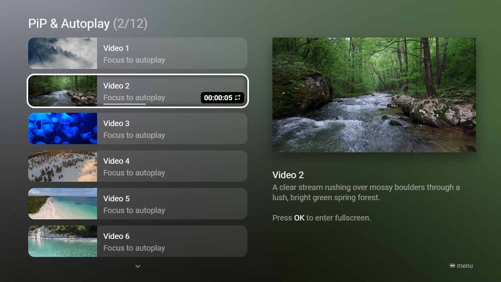

# PiP & Autoplay

It is possible to automatically play the video/audio of a content item as soon as it gets the focus (autoplay). In combination with a special video plugin, the video can additionally be displayed in a specific area of the content while it is still focused (picture-in-picture, PiP). The autoplay feature is available since version **0.1.167**. The PiP plugin also works with older versions.

## Usage

### Autoplay

The autoplay actions execute the video/audio action of a content item in auto mode. In auto mode, the player is not displayed, so the video/audio is started in the background and the content remains focused. If the user presses **OK** afterwards, the video/audio can be moved to the foreground.

Action syntax of autoplay actions.

| Syntax | Example | Since Version | Description |
|---|---|---|---|
| `autoplay` | `autoplay` | **0.1.167** | Executes the video/audio action of the currently focused item in auto mode. If the focused item does not contain a video/audio action, or if no item is focused at all (e.g. if the menu is focused), the first item of the current context that contains a video/audio action is used instead. If no video/audio action can be found, the action is ignored. |
| `autoplay:{FOCUS}` | `autoplay:content_item_id`<br>`autoplay:index:0`<br>`autoplay:random` | **0.1.167** | Executes the video/audio action of the item that would be focused by the action `focus:{FOCUS}` (without actually focusing it) in auto mode. If this item does not exist (e.g. if an unknown ID is indicated), the currently focused item is used instead (like with the action `autoplay`). If the item does not contain a video/audio action, the first item of the current context that contains a video/audio action is used instead. If no video/audio action can be found, the action is ignored. |

To start the video/audio of a focused content item automatically, the autoplay action can be executed with a [Selection Object](../selection/selection-object.md). It is recommended to execute it with a short delay (e.g. `delay:autoplay:1:autoplay`), so that a quick navigation through the items does not start a new video/audio for each item. Because there can only be one pending delay action per ID, each new selection automatically cancels the previous pending autoplay action. If the item is executed (e.g. clicked) before the delay has expired, the pending autoplay action can be canceled with the extended property `"trigger:execute": "delay:autoplay:cancel"`. For more information, please see [Extended Properties](../special/extended-properties.md) and [Internal Actions](../special/internal-actions.md).

### PiP Plugin

This is a special video plugin that plays a video in an endless loop and displays it in a picture-in-picture area of the content as long as the content is focused. If the video is moved to the foreground (e.g. by pressing **OK**), it is displayed in fullscreen mode. Please see following action syntax examples.

- `video:plugin:http://msx.benzac.de/plugins/pip.html?url={URL}`
- `video:plugin:http://msx.benzac.de/plugins/pip.html?url={URL}&backdrop={COLOR_1}|{COLOR_2}|{COLOR_3}`
- `video:plugin:http://msx.benzac.de/plugins/pip.html?url={URL}&backdrop=transparent:{NUMBER}`

The PiP mode is automatically handled by the plugin by observing the content state.

- The PiP mode is enabled if the content is visible, has the focus, and has the flag `"pip"` (i.e. the content `flag` property is set to `"pip"`).
- The PiP mode is disabled if the video is active (i.e. in foreground).
- In all other cases, the running video is stopped (by executing the action `quiet`).

The PiP mode is retained when the next PiP video is loaded, so that it starts directly in the PiP area. Additionally, the PiP mode can be controlled with the following custom events (please see action `event:{EVENT_ID}` in [Internal Actions](../special/internal-actions.md)).

- `event:pip:enable`: Enables the PiP mode.
- `event:pip:disable`: Disables the PiP mode.
- `event:pip:validate`: Validates the PiP mode according to the current content state (see above).

Because the content state is observed in a 1-second cycle, the event `event:pip:validate` can be used to validate the PiP mode immediately (e.g. with an underlay page action, see example below). The plugin can easily handle multiple identical events (e.g. if the PiP mode is already enabled, enabling it again has no effect).

**Note: The PiP area has a fixed position and size (in the upper right part of the screen). Therefore, the content must be designed accordingly (e.g. by keeping the upper right area clear of content items), otherwise the plugin cannot be used meaningfully. If you need a different PiP area, the plugin can easily be adapted.**

The PiP area is defined by a placeholder element in the plugin HTML page. The values of this placeholder are applied to the video in PiP mode.

```css
body
{
    /*Make body transparent to support transparent videos (available since MSX version 0.1.168)*/
    background: transparent;
}
.placeholder
{
    /*Placeholder values will be applied to the video in pip mode*/
    display: none;
    top: 13.333%; /*96px @ 720p*/
    right: 5%; /*64px @ 720p*/
    width: 40.625%; /*520px @ 720p*/
    height: 40.625%; /*292.5px @ 720p*/
    background: black;
    box-shadow: 0px 16px 32px rgba(0, 0, 0, 0.4);
}
.pip-mode .placeholder
{
    display: block;
}
/*Only show placeholder if pip is ready (i.e. all values have been correctly calculated)*/
/*Only show player if video is ready (i.e. pip is ready and video is ready to play)*/
.placeholder,
.player
{
    visibility: hidden;
}
.pip-ready .placeholder,
.video-ready .player
{
    visibility: visible;
}
```

The placeholder is located inside a content wrapper element that is managed by the helper script [http://msx.benzac.de/plugins/js/content-controller.js](http://msx.benzac.de/plugins/js/content-controller.js). This script is needed for the immersive mode (**Settings** → **Immersive Mode**): The entire MSX user interface is always displayed in 16:9 format, but if the immersive mode is enabled, the plugin page can have a different format. Therefore, the content wrapper is centered in the plugin page with the 16:9 screen size of the application (and scaled with its zoom factor), so that the placeholder matches exactly the corresponding area of the content. The content wrapper is set up again if the immersive mode setting is changed or the application is resized. Each time the content wrapper is set up (and each time the window is resized), the current position and size of the placeholder are applied to the video.

To prevent the PiP area from jumping while the plugin is loading, the placeholder and the video are initially hidden (but still laid out), so that all calculations can be performed in advance. The plugin sets the following CSS classes on the `body` element to make them visible step by step.

- `pip-ready`: This class is set as soon as the application settings have been validated (i.e. the content wrapper has been set up correctly). From this point on, the placeholder is visible (if the PiP mode is enabled).
- `video-ready`: This class is set as soon as the video is ready to play. From this point on, the video is visible.

**Note: This is a pure plugin feature, so it also works with older versions.**

Additionally, the `body` element of the plugin page has a transparent background. Together with the extended property `"video:transparent": "true"` (available since version **0.1.168**), the underlying background is displayed behind the plugin instead of a black screen (e.g. while switching between videos). For more information, please see [Extended Properties](../special/extended-properties.md).

If you would like to use the plugin as reference to implement your own plugin, please have a look at this implementation script: [https://msx.benzac.de/plugins/js/pip.js](https://msx.benzac.de/plugins/js/pip.js).

## Syntax

Parameter syntax of PiP plugin.

| Parameter | Type | Default Value | Mandatory | Description |
|---|---|---|---|---|
| `url` | `string` | `null` | **Yes** | The URL of the PiP video. It is recommended to encode the value to ensure that it is evaluated correctly (e.g. `"http://msx.benzac.de/media/video1.mp4"` → `"http%3A%2F%2Fmsx.benzac.de%2Fmedia%2Fvideo1.mp4"`). |
| `backdrop` | `string` | `null` | No | The colors of an atmospheric backdrop that is generated as gradient background behind the video. Exactly three colors must be indicated, separated by `\|` (e.g. `"#1c3249\|#646f78\|#c4c5c3"`). All CSS color formats can be used. If not exactly three valid colors are indicated, no backdrop is generated. The backdrop is generated in the same way as with the [Backdrop Plugin](../plugins/backdrop-plugin.md), except that the three colors are indicated directly instead of being extracted from an image. It is recommended to encode the value to ensure that it is evaluated correctly (e.g. `"#1c3249\|#646f78\|#c4c5c3"` → `"%231c3249%7C%23646f78%7C%23c4c5c3"`).<br><br>Alternatively, the special value `"transparent:{NUMBER}"` can be indicated. In this case, no backdrop is generated and only the opacity of the default background (i.e. the default MSX gradient from dark gray to black) is set. The number is a relative floating point number and can go from `0.0` to `1.0`. This can be used to darken the underlying background image (e.g. `"transparent:0.5"`) or to display it without any darkening (`"transparent:0"`).<br><br>**Note: The value `"transparent:{NUMBER}"` is only meaningful if the extended property `"video:transparent"` is set to `"true"` (available since version 0.1.168). Otherwise, the video scene background is black, so the default background is only displayed on top of a black area and simply appears darker.** |
| `loop` | `number` | `1` | No | Indicates if the PiP video is played in an endless loop.<br><br>• `0`: The video is played once and the playback is stopped when it has ended.<br>• `1`: The video is played in an endless loop. |

## Example

Please note that this example uses some properties that are only available in version **0.1.167** or higher. The example combines autoplay and the PiP plugin as follows.

- The content `flag` is set to `"pip"`, so that the PiP mode is enabled while the content is focused. The template `area` keeps the right part of the screen clear of content items, where the PiP video and the description of the focused item (overlay item `text`) are displayed.
- The content `transparent` property is set to `2` and the extended property `"control:transparent"` is set to `"true"`, so that the content background is transparent while a PiP video is active.
- The extended property `"video:transparent"` is set to `"true"`, so that the transitions between the videos are smoother: Instead of briefly switching to a black screen when the next video is loaded, the underlying background is displayed. This property is only available in version **0.1.168** or higher (in older versions, it is ignored).
- The selection action updates the overlay item `text` with the description of the focused item and starts the autoplay action after a delay of 1 second. The selection is set to `important`, so that the item action is only executed if the item has the focus (when using mouse or touch). The custom `description` property is only used for the `{context:description}` expression.
- The extended property `"trigger:execute": "delay:autoplay:cancel"` cancels a pending autoplay action if the item is executed before the delay has expired.
- The extended property `"control:reuse": "retain"` ensures that the running PiP video is reused (and not restarted) if the item is executed. The extended property `"trigger:active": "event:pip:disable"` disables the PiP mode when the video moves to the foreground and `"trigger:inactive": "event:pip:validate"` validates the PiP mode when the video moves to the background.
- The underlay page action `event:pip:validate` validates the PiP mode when the content becomes visible. Additionally, an underlay page action is also executed when the content becomes inactive (i.e. if the menu gets the focus and the content is still visible). Therefore, the running video is stopped very quickly when the user moves to the menu. The content observer of the plugin would also stop the video (within its 1-second cycle), but the page action makes it faster. For more information, please see [Page Action](page-action.md).
- The `live` object of type `"playback"` shows the playback time of the running video in the stamp and executes the action `player:show` instead of the item action while the video is running. For more information, please see [Live Object](../live/live-object.md).
- The extended property `"control:timeout"` is set to `3` seconds, so that the player is hidden shortly after the video has moved to the foreground.

Some of these properties are redundant and only act as additional safety nets. For example, the extended property `"control:reuse": "retain"` is not strictly needed, because the `live` object already executes the action `player:show` instead of the item action while the video is running (or paused). It only becomes relevant if the `live` object or its action is removed. Likewise, the extended property `"trigger:execute": "delay:autoplay:cancel"` is only included for safety (and cleanliness): If a video is executed, it is displayed in fullscreen mode (with or without the player), where the autoplay action has no effect (it is simply ignored). Nevertheless, it is recommended to keep these properties, because they make the content safer and cleaner.

### Screenshot



### Code

```json
{
    "type": "list",
    "headline": "PiP & Autoplay",
    "flag": "pip",
    "transparent": 2,
    "navigationSpan": 6,
    "template": {
        "type": "default",
        "layout": "0,0,6,1",
        "area": "0,0,6,6",
        "wrapperColor": "msx-glass",
        "imageWidth": 1.83,
        "color": "msx-glass",
        "imageFiller": "cover",
        "stamp": "",
        "progress": -1,
        "titleHeader": "Video",
        "titleFooter": "Focus to autoplay",
        "truncation": "titleHeader|titleFooter",
        "description": "",
        "selection": {
            "important": true,
            "action": "[update:content:overlay:text|delay:autoplay:1:autoplay]",
            "data": {
                "headline": "{context:titleHeader}",
                "text": "{context:description}{br}{br}Press {txt:msx-white:OK} to enter fullscreen."
            }
        },
        "live": {
            "type": "playback",
            "stamp": "",
            "running": {
                "stamp": "{progress:time:hh:mm:ss} {ico:repeat}"
            },
            "action": "player:show"
        },
        "properties": {
            "control:type": "extended",
            "control:transparent": true,
            "control:reuse": "retain",
            "control:timeout": 3,
            "trigger:active": "event:pip:disable",
            "trigger:inactive": "event:pip:validate",
            "trigger:execute": "delay:autoplay:cancel",
            "label:duration": "{VALUE} {ico:repeat}",
            "video:transparent": true
        }
    },
    "underlay": {
        "action": "event:pip:validate"
    },
    "overlay": {
        "items": [{
                "id": "text",
                "type": "space",
                "layout": "7,3,5,3",
                "offset": "-0.5,0.5,0.5,-0.5",
                "headline": "",
                "text": ""
            }]
    },
    "items": [{
            "titleHeader": "{col:msx-white}Video 1",
            "playerLabel": "Video 1",
            "description": "Dark conifer trees on a mountain slope, partly hidden by thick drifting fog and clouds.",
            "image": "http://msx.benzac.de/media/thumbs/video1.jpg",
            "action": "video:plugin:http://msx.benzac.de/plugins/pip.html?url=http://msx.benzac.de/media/video1.mp4&backdrop=#1c3249|#646f78|#c4c5c3"
        }, {
            "titleHeader": "{col:msx-white}Video 2",
            "playerLabel": "Video 2",
            "description": "A clear stream rushing over mossy boulders through a lush, bright green spring forest.",
            "image": "http://msx.benzac.de/media/thumbs/video2.jpg",
            "action": "video:plugin:http://msx.benzac.de/plugins/pip.html?url=http://msx.benzac.de/media/video2.mp4&backdrop=#181912|#4b6e3b|#9ea5b3"
        }, {
            "titleHeader": "{col:msx-white}Video 3",
            "playerLabel": "Video 3",
            "description": "Many translucent moon jellyfish glowing in bright blue light against a dark aquarium background.",
            "image": "http://msx.benzac.de/media/thumbs/video3.jpg",
            "action": "video:plugin:http://msx.benzac.de/plugins/pip.html?url=http://msx.benzac.de/media/video3.mp4&backdrop=#010a4f|#013cf1|#00c1ff"
        }, {
            "titleHeader": "{col:msx-white}Video 4",
            "playerLabel": "Video 4",
            "description": "Aerial view of a snowy hillside dotted with spruce trees, lit by warm golden sunlight.",
            "image": "http://msx.benzac.de/media/thumbs/video4.jpg",
            "action": "video:plugin:http://msx.benzac.de/plugins/pip.html?url=http://msx.benzac.de/media/video4.mp4&backdrop=#352c24|#8c8f94|#e7c099"
        }, {
            "titleHeader": "{col:msx-white}Video 5",
            "playerLabel": "Video 5",
            "description": "Aerial view of a white sandy beach with green vegetation next to turquoise water under a blue sky.",
            "image": "http://msx.benzac.de/media/thumbs/video5.jpg",
            "action": "video:plugin:http://msx.benzac.de/plugins/pip.html?url=http://msx.benzac.de/media/video5.mp4&backdrop=#33321c|#559691|#ddcec6"
        }, {
            "titleHeader": "{col:msx-white}Video 6",
            "playerLabel": "Video 6",
            "description": "A secluded cove with crystal-clear turquoise water, white limestone cliffs, pine trees and driftwood on the shore.",
            "image": "http://msx.benzac.de/media/thumbs/video6.jpg",
            "action": "video:plugin:http://msx.benzac.de/plugins/pip.html?url=http://msx.benzac.de/media/video6.mp4&backdrop=#191f17|#588578|#c7c9c5"
        }, {
            "titleHeader": "{col:msx-white}Atmos 1",
            "playerLabel": "Atmos 1",
            "description": "Teal and cyan bokeh particles drifting through dark space, glowing brightest in the center like a nebula.",
            "image": "http://msx.benzac.de/media/thumbs/atmos1.jpg",
            "action": "video:plugin:http://msx.benzac.de/plugins/pip.html?url=http://msx.benzac.de/media/atmos1.mp4&backdrop=#011315|#02657f|#3db5d9"
        }, {
            "titleHeader": "{col:msx-white}Atmos 2",
            "playerLabel": "Atmos 2",
            "description": "Golden light rays falling from above onto a field of sparkling orange-gold particles on a black background.",
            "image": "http://msx.benzac.de/media/thumbs/atmos2.jpg",
            "action": "video:plugin:http://msx.benzac.de/plugins/pip.html?url=http://msx.benzac.de/media/atmos2.mp4&backdrop=#250b01|#c65f05|#f4c70a"
        }, {
            "titleHeader": "{col:msx-white}Atmos 3",
            "playerLabel": "Atmos 3",
            "description": "Abstract silver-white particle waves flowing in front of a blurred blue-grey striped background.",
            "image": "http://msx.benzac.de/media/thumbs/atmos3.jpg",
            "action": "video:plugin:http://msx.benzac.de/plugins/pip.html?url=http://msx.benzac.de/media/atmos3.mp4&backdrop=#2a3351|#64697f|#cacbd5"
        }, {
            "titleHeader": "{col:msx-white}Atmos 4",
            "playerLabel": "Atmos 4",
            "description": "Underwater scene in deep blue, with air bubbles rising toward the surface through beams of sunlight.",
            "image": "http://msx.benzac.de/media/thumbs/atmos4.jpg",
            "action": "video:plugin:http://msx.benzac.de/plugins/pip.html?url=http://msx.benzac.de/media/atmos4.mp4&backdrop=#06233a|#125a8e|#2dc2fe"
        }, {
            "titleHeader": "{col:msx-white}Atmos 5",
            "playerLabel": "Atmos 5",
            "description": "Close-up of a dark rippling ocean surface catching faint pale light at dusk.",
            "image": "http://msx.benzac.de/media/thumbs/atmos5.jpg",
            "action": "video:plugin:http://msx.benzac.de/plugins/pip.html?url=http://msx.benzac.de/media/atmos5.mp4&backdrop=#05131f|#3a4c53|#90958c"
        }, {
            "titleHeader": "{col:msx-white}Atmos 6",
            "playerLabel": "Atmos 6",
            "description": "City skyline at night with high-rise towers and glowing traffic, seen through a rain-covered window.",
            "image": "http://msx.benzac.de/media/thumbs/atmos6.jpg",
            "action": "video:plugin:http://msx.benzac.de/plugins/pip.html?url=http://msx.benzac.de/media/atmos6.mp4&backdrop=#100f0e|#632f24|#dcd9d4"
        }]
}
```

### Demo

- [Launch via App](https://msx.benzac.de/?start=content:https://msx.benzac.de/info/xp/data/hidden_feature_21.json)
- [Launch via Demo Page](https://msx.benzac.de/info/?start=content:https://msx.benzac.de/info/xp/data/hidden_feature_21.json)

## See Also

- [Internal Actions](../special/internal-actions.md) — the `autoplay`, `autoplay:{FOCUS}`, `delay:{ACTION_ID}:...`, `event:{EVENT_ID}`, `quiet`, and `player:show` rows
- [Selection Object](../selection/selection-object.md)
- [Extended Properties](../special/extended-properties.md) — `control:reuse`, `control:transparent`, `control:timeout`, `control:type`, `video:transparent`, `trigger:{TRIGGER_KEY}` (incl. `active`, `inactive`, `execute`), `label:duration`
- [Page Action](page-action.md)
- [Live Object](../live/live-object.md)
- [Background Plugin](../plugins/background-plugin.md)
- [Backdrop Plugin](../plugins/backdrop-plugin.md)
- [Video/Audio Plugin](../plugins/video-audio-plugin.md)
- [Plugin API Reference](../plugins/plugin-api-reference.md)
- [Actions Reference](../../reference/actions-reference.md) — consolidated Main + Internal actions with since-versions
